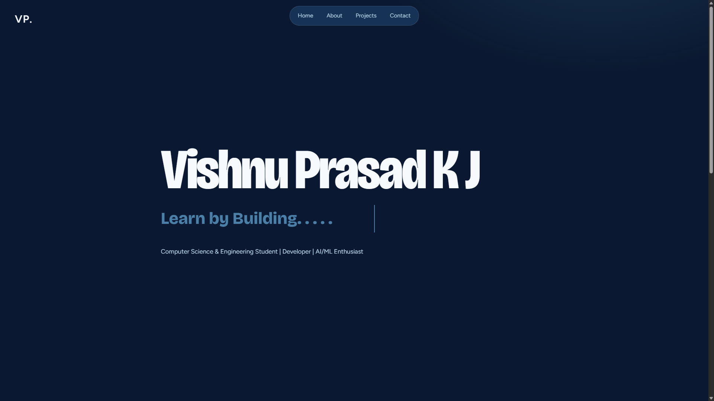
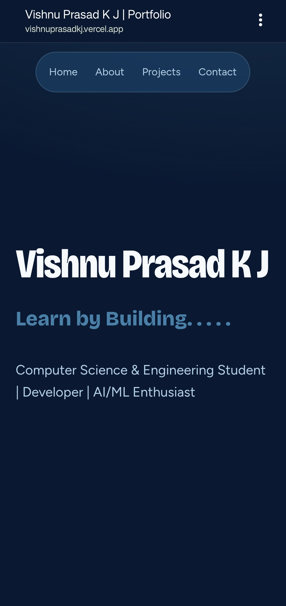

<h2 align="center">
  Vishnu Prasad K J — Portfolio<br/>
  <a href="https://vishnuprasadkj.vercel.app/" target="_blank">vishnuprasadkj.vercel.app</a>
</h2>

<div align="center">
  
</div>

<br/>

<div align="center">


</div>

---

## About

A personal portfolio website showcasing my journey as a Computer Science and Engineering student, developer, and AI/ML enthusiast.

Built with a minimal aesthetic, modern typography, and a clean dark interface.

**Learn by Building.**

## Live Demo

Explore the portfolio:

**[vishnuprasadkj.vercel.app](https://vishnuprasadkj.vercel.app/)**

## Built With

This project was developed using the following technologies:

- React.js
- Vite
- CSS3
- JavaScript
- React Icons
- Visual Studio Code
- Vercel

## Features

**Minimal & Modern Design**

A clean, dark-themed interface with bold typography and minimal visual distractions.

**Responsive Layout**

Designed to provide a consistent experience across desktop and mobile devices.

**Smooth Navigation**

Simple navigation between Home, About, Projects, and Contact sections.

**Interactive Elements**

Subtle animations and interactive elements for a better browsing experience.

**Project Showcase**

A dedicated section highlighting personal projects and development work.

**Contact & Social Links**

Quick access to my professional profiles and contact information.

## Screenshots

### Desktop View

<div align="center">
  
</div>

### Mobile View

<div align="center">
  
</div>

## Getting Started

To run this project locally, you need Node.js and Git installed on your system.

### Installation and Setup Instructions

**1. Clone the repository**

```bash
git clone https://github.com/vishnuprasad06/Portfolio.git
```

**2. Navigate to the project directory**

```bash
cd Portfolio
```

**3. Install dependencies**

```bash
npm install
```

**4. Start the development server**

```bash
npm run dev
```

Open the local URL displayed in your terminal to view the website.

## Build for Production

```bash
npm run build
```

To preview the production build:

```bash
npm run preview
```

## Deployment

This portfolio is deployed using **Vercel**.

Every update pushed to the connected GitHub repository can be automatically deployed through Vercel.

## Author

**Vishnu Prasad K J**

Computer Science & Engineering Student | Developer | AI/ML Enthusiast

- Portfolio: [vishnuprasadkj.vercel.app](https://vishnuprasadkj.vercel.app/)
- GitHub: [@vishnuprasad06](https://github.com/vishnuprasad06)

---

<div align="center">
  <h3>Learn by Building.</h3>
  <p>Designed & Developed by Vishnu Prasad K J</p>
</div>