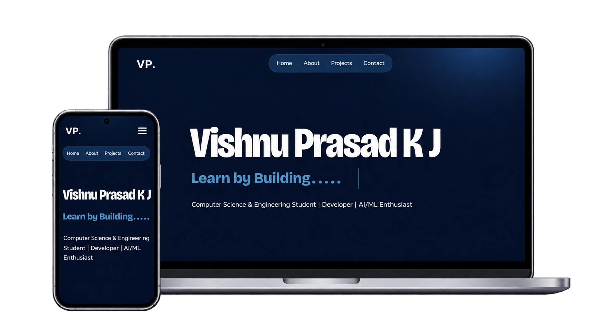

<h2 align="center">
  Portfolio Website - Vishnu Prasad K J 
  <a href="https://vishnuprasadkj.vercel.app/" target="_blank">vishnuprasadkj.vercel.app</a>
</h2>

  

 

 &nbsp;
 &nbsp;
 &nbsp;
 &nbsp;

<h3 align="center">
  🔹
  <a href="https://github.com/vishnuprasad06/Portfolio/issues">Report Bug</a> &nbsp; &nbsp;
  🔹
  <a href="https://github.com/vishnuprasad06/Portfolio/issues">Request Feature</a>
</h3>

## TL;DR

A personal portfolio website built to showcase my projects, technical skills, interests, and journey as a Computer Science and Engineering student.

Feel free to explore the source code and get inspired!

## Built With

My personal portfolio, <a href="https://vishnuprasadkj.vercel.app/" target="_blank">vishnuprasadkj.vercel.app</a>, showcases my work, projects, and interests in software development and Artificial Intelligence.

This project was built using these technologies.

- React.js
- Vite
- JavaScript
- CSS3
- React Icons
- Visual Studio Code
- Vercel

## Features

**📖 Clean and Minimal Layout**

**🎨 Modern Dark Theme with Custom Styling**

**📱 Fully Responsive Design**

**⚡ Smooth Navigation and Animations**

**💻 Personal Projects Showcase**

**🔗 Social Media and Contact Integration**

## Getting Started

Clone this repository to explore or run the project locally. You will need `Node.js` and `Git` installed globally on your machine.

## 🛠 Installation and Setup Instructions

1. Clone the repository:

   `git clone https://github.com/vishnuprasad06/Portfolio.git`

2. Navigate to the project directory:

   `cd Portfolio`

3. Install dependencies:

   `npm install`

4. In the project directory, run:

   `npm run dev`

Runs the app in development mode.

Open the local URL displayed in your terminal to view it in the browser.

The page will reload if you make edits.

## Usage Instructions

Open the project folder and navigate to `/src/`.

You will find the components and files used to build the portfolio. You can edit the personal information, projects, styles, and other content according to your preferences.

## Deployment

This portfolio is deployed using **Vercel**.

Updates pushed to the connected GitHub repository are automatically deployed.

---

  <h3>Learn by Building.</h3>
  
Designed & Developed by Vishnu Prasad K J

